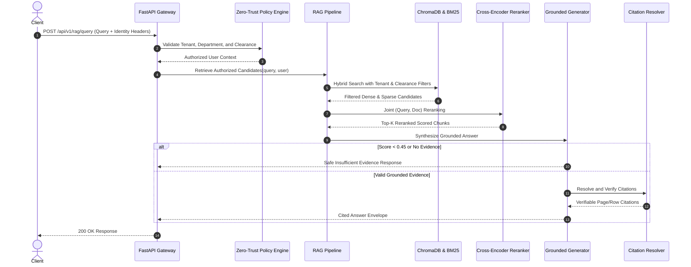

# Architecture & System Design: Sentinel Enterprise AI Fabric

## 1. System Overview

Sentinel Enterprise AI Fabric follows a modular monolith architectural pattern designed for high cohesion, localized failure isolation, and zero-trust security boundaries. It orchestrates four primary subsystems:

1. **Legacy Data Ingestion and Vector ETL Subsystem**
2. **Adversarially Hardened Multi-Tenant RAG Subsystem**
3. **Governed Autonomous ERP/CRM Agent Subsystem**
4. **Application Gateway and Observability Subsystem**

```mermaid
flowchart TD
    subgraph Gateway [Gateway & Policy Layer]
        API[FastAPI Application Gateway]
        AUTH[Zero-Trust Policy Engine<br/>Tenant / Dept / Clearance]
        OBS[Prometheus & JSON Logger]
    end

    subgraph ETL [Workstream A: Ingestion Pipeline]
        ING[Ingestion Controller]
        EXTRACT[Format Extractors<br/>PDF | CSV | Markdown]
        CHUNKER[Structure-Aware Chunker]
        CHROMA[(ChromaDB Persistent Store)]
        BM25[(BM25 Sparse Index)]
    end

    subgraph RAG [Workstream B: Multi-Tenant RAG]
        REWRITE[Query Sanitizer & Rewriter]
        HYBRID[Hybrid Retrieval & RRF Fusion]
        RERANK[Cross-Encoder Reranker]
        ABSTAIN{Grounding Score >= 0.45?}
        GEN[Grounded Generator]
        ABST_MSG[Safe Insufficient Evidence Return]
        CIT[Citation Resolver & Verifier]
    end

    subgraph Agent [Workstream C: Governed Agent]
        AGENT[Agent Execution Engine]
        TOOLS[Typed Pydantic Tool Registry]
        WRITE_GATE{State Changing?}
        APPR[Two-Phase HMAC Approval Gate]
        MOCK[(Mock ERP/CRM Backend)]
        AUDIT[(Append-Only Audit Log)]
    end

    API --> AUTH
    API --> OBS
    AUTH --> ING
    ING --> EXTRACT --> CHUNKER --> CHROMA & BM25

    AUTH --> REWRITE --> HYBRID --> RERANK --> ABSTAIN
    ABSTAIN -- Yes --> GEN --> CIT
    ABSTAIN -- No --> ABST_MSG

    AUTH --> AGENT --> TOOLS --> WRITE_GATE
    WRITE_GATE -- Yes --> APPR
    WRITE_GATE -- No --> MOCK
    APPR -- Approved --> MOCK
    MOCK --> AUDIT
```

---

## 2. Ingestion Pipeline Stages (Workstream A)

The ingestion pipeline executes across nine explicit, observable stages:

1. **DISCOVER**: Inspect incoming payload or file batches, determine MIME types, and assign UUID tracking handles.
2. **VALIDATE**: Check file sizes against `MAX_UPLOAD_SIZE_BYTES` (25MB), verify non-empty byte content, and confirm format compatibility.
3. **EXTRACT**: Format-specific extraction:
   - **PDF**: Page-by-page text extraction tracking 1-indexed page provenance.
   - **CSV**: Tabular record parsing normalizing headers and values while tracking row identifiers.
   - **Markdown**: Heading hierarchy tracking (`H1` to `H6`), section path assembly, and code block preservation.
4. **NORMALIZE**: Strip non-printable ASCII control characters, normalize whitespace, and enforce UTF-8 text encoding.
5. **CHUNK**: Structure-aware sliding window chunking respecting natural sentence and paragraph boundaries while attaching `page_number`, `row_id`, and `heading_path` metadata.
6. **EMBED**: Compute dense vector representations using deterministic local mock or local Ollama embeddings.
7. **INDEX**: Upsert chunks into ChromaDB (dense cosine index) and in-memory Okapi BM25 (sparse index).
8. **VERIFY**: Query indexed identifiers to ensure transactional write integrity and metadata availability.
9. **REPORT**: Compile comprehensive `IngestionManifest` recording processed, duplicate-skipped, and failed records.

---

## 3. Adversarial RAG Data Flow (Workstream B)



---

## 4. Governed Agent Architecture (Workstream C)

The agent operates strictly through an explicit tool registry and policy engine:

- **Read-Only Tools** (`inventory_lookup`, `customer_lookup`, `ticket_status_lookup`, `operation_status_check`):
  Execute directly against the backend data store within the caller's tenant boundary.
- **State-Changing Tools** (`lead_status_update`, `support_ticket_create`):
  Intercepted by the **Two-Phase Approval Gate**.
  1. Creates a pending operation bound by HMAC-SHA256 signature to the operation parameters.
  2. Issues a time-bound approval token (15-minute TTL).
  3. Re-execution requires explicit submission of the approval token to `POST /api/v1/approvals/{operation_id}`.
  4. Consumed tokens are permanently marked to prevent replay attacks.
- **Audit Logging**:
  Every attempt, validation outcome, approval request, and tool invocation is logged to an immutable append-only JSONL file.

---

## 5. Deployment Architecture (Workstream D)

- **Containerization**: Hardened multi-stage Dockerfile based on `python:3.12-slim`.
- **Security Hardening**: Drops all root capabilities, executes under unprivileged UID `10001` (`sentinel:sentinel`), enforces `no-new-privileges:true`.
- **Persistent Storage**: Volumes mapped to `./data` for ChromaDB vector indices and audit event logs.
- **Observability**: Prometheus metrics scraped via `/metrics`; health probes exposed at `/health/live` and `/health/ready`.
