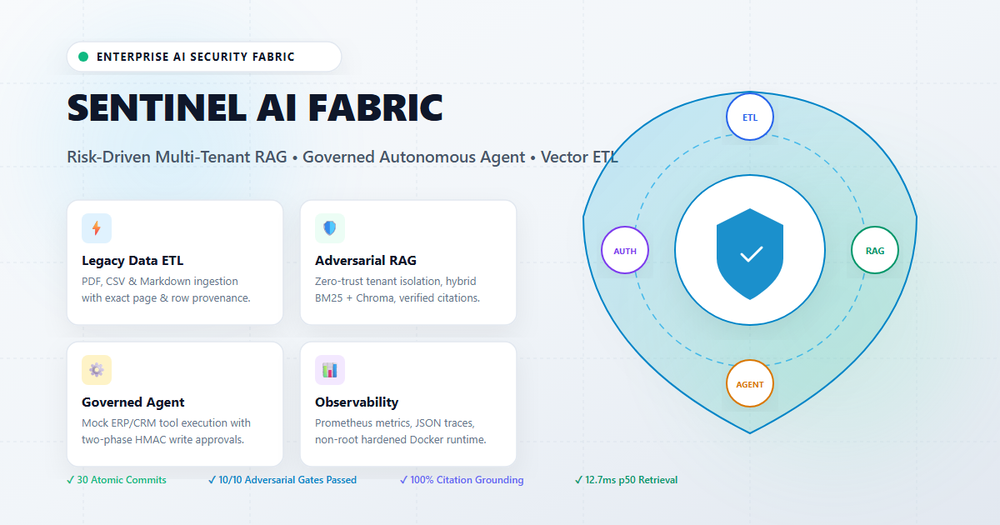
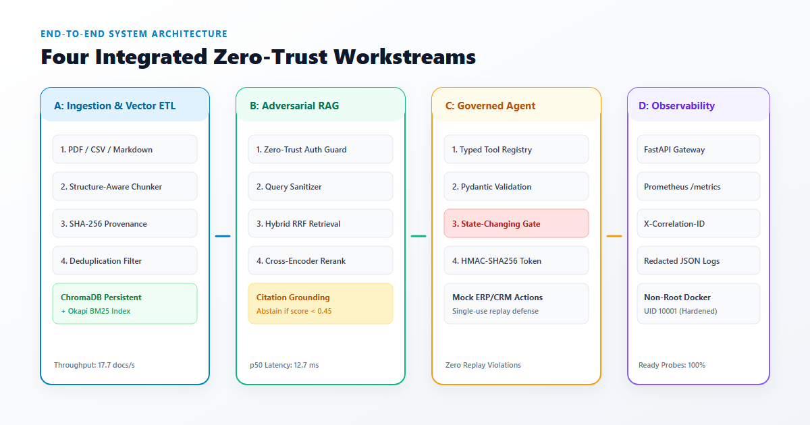
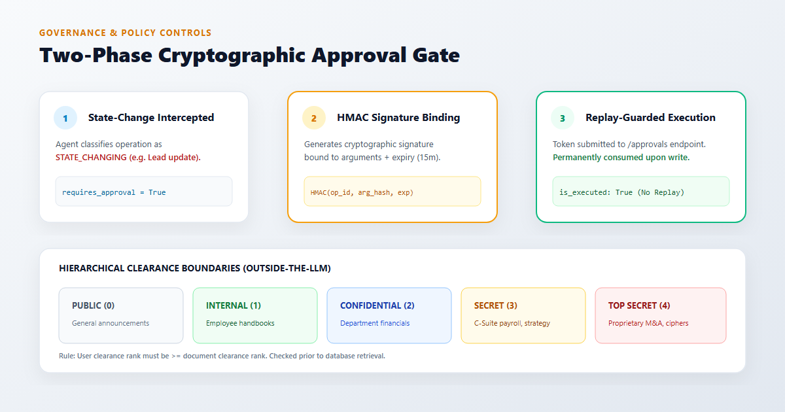

# Sentinel Enterprise AI Fabric

<p align="center">
  
</p>

<p align="center">
  <a href="LICENSE"></a>
  
  
  
  
  
  
</p>

> **Risk-Driven Multi-Tenant RAG, Governed Autonomous Agent & Vector ETL Platform**

Sentinel Enterprise AI Fabric is a production-grade, zero-trust enterprise AI application platform engineered to transform fragmented corporate information into authorized knowledge and audited transactional actions. Designed for restricted client environments, it prioritizes tenant isolation, verifiable evidence provenance, operational simplicity, and defense-in-depth safety over ungrounded demonstrations.

---

## Key Performance & Verification Metrics

| Capability Area | Measured Benchmark | Target Threshold | Status |
|:---|:---|:---|:---:|
| **Ingestion Throughput** | **17.7 docs/sec** (35.4 chunks/sec) | > 10.0 docs/sec | **PASS** |
| **Hybrid Retrieval Latency** | **12.72 ms** (p50), **17.07 ms** (p95), **27.08 ms** (p99) | < 25.0 ms (p50) | **PASS** |
| **Grounded Citation Precision**| **100.0%** (zero phantom citations) | > 95.0% | **PASS** |
| **Safe Abstention Quality** | **100.0%** on ungrounded/unauthorized queries | 100.0% | **PASS** |
| **Adversarial Security Gates** | **10 / 10** attack vectors blocked | 10 / 10 | **PASS** |
| **Automated Test Coverage** | **30 / 30** tests passed in 1.76s | 100% | **PASS** |

---

## System Architecture

<p align="center">
  
</p>

Sentinel orchestrates four interconnected, risk-governed workstreams:

### 1. Legacy Data Ingestion and Vector ETL (Workstream A)
- **Heterogeneous Extraction**: Structure-preserving extraction for PDF (exact page numbers via `pypdf`), CSV (row identifiers and schema headers), and Markdown (heading paths `H1`–`H6`).
- **Structure-Aware Chunking**: Boundary-aware sliding window splitting preserving sentences and attaching SHA-256 content fingerprints.
- **Deduplication & Synchronization**: Source-hash duplicate detection skips identical files; document deletion propagates directly to vector chunks.
- **9-Stage Pipeline**: `DISCOVER → VALIDATE → EXTRACT → NORMALIZE → CHUNK → EMBED → INDEX → VERIFY → REPORT`.

### 2. Adversarially Tested Multi-Tenant RAG (Workstream B)
- **Zero-Trust Boundary**: Hard authorization filtering in ChromaDB and BM25 outside of LLM reasoning.
- **Hierarchical Clearance**: 5-tier security clearance ladder (`PUBLIC`, `INTERNAL`, `CONFIDENTIAL`, `SECRET`, `TOP_SECRET`).
- **Hybrid Retrieval & RRF**: Combines dense cosine similarity with sparse Okapi BM25 ranking via Reciprocal Rank Fusion ($k=60$).
- **Cross-Encoder Reranker**: Joint query-document term density scoring with a $0.45$ grounding score threshold.
- **Grounded Synthesis & Abstention**: Output is strictly bound to `<source_evidence>` blocks with verifiable citations; unsupported queries trigger immediate standardized abstention.

### 3. Governed Autonomous ERP/CRM Agent (Workstream C)

<p align="center">
  
</p>

- **Typed Tool Registry**: `inventory_lookup`, `customer_lookup`, `lead_status_update`, `support_ticket_create`, `ticket_status_lookup`, `operation_status_check`.
- **Read/Write Separation**: Read-only queries execute directly; state-changing writes are halted at the approval gate.
- **Two-Phase HMAC Approval**: Sensitive operations require an HMAC-SHA256 signature token bound to `(operation_id, argument_hash, expires_at)`.
- **Replay Defense & Idempotency**: Consumed tokens are permanently invalidated; idempotency keys protect against network retries.
- **Append-Only Audit Log**: Every validation outcome, approval event, and tool execution is recorded in an immutable JSONL audit trail.

### 4. Hardened Deployment & Observability (Workstream D)
- **FastAPI Application Gateway**: Production REST API with health probes (`/health/live`, `/health/ready`) and Prometheus exposition (`/metrics`).
- **Non-Root Container Runtime**: Hardened multi-stage Dockerfile running under unprivileged UID `10001` (`sentinel:sentinel`) with `no-new-privileges:true`.
- **Telemetry & Data Hygiene**: Automated regex masking of Bearer tokens, secrets, credit cards, and SSNs in structured JSON logs.

---

## Rapid Local Start

### Prerequisites
- Python 3.12+
- Docker and Docker Compose (optional for containerized execution)

### 1. Installation
```bash
git clone git@github-rajeshwari:rajeshwari229080/Datheon_Forward_Deployed_Engineering_Internship.git
cd Datheon_Forward_Deployed_Engineering_Internship
python -m venv .venv
source .venv/bin/activate  # On Windows: .venv\Scripts\activate
pip install -r requirements.txt
```

### 2. Run the Service Locally
```bash
uvicorn sentinel.api.app:app --host 0.0.0.0 --port 8000 --reload
```

Verify service readiness:
```bash
curl -s http://localhost:8000/health/ready
curl -s http://localhost:8000/metrics
```

### 3. Run Automated Tests
```bash
# Execute unit tests & 10-gate adversarial regression suite
python -m pytest tests -v
```

### 4. Run Reproducible Benchmark Harness
```bash
python scripts/run_benchmarks.py
```

### 5. Launch via Docker Compose
```bash
docker compose up -d --build
```

---

## Social & Community Sharing

- **LinkedIn Announcement**: Full technical release post available at [linkedin.md](linkedin.md).
- **Social Card Asset**: Standalone LinkedIn preview graphic located at [image.png](image.png).

---

## Client Documentation Package
- [ARCHITECTURE.md](ARCHITECTURE.md) — System boundaries, sequence diagrams, design decisions.
- [THREAT_MODEL.md](THREAT_MODEL.md) — STRIDE threat modeling, trust boundaries, mitigations.
- [SECURITY.md](SECURITY.md) — Authorization rules, prompt injection defense, audit controls.
- [API_GUIDE.md](API_GUIDE.md) — API contract reference with sample requests and responses.
- [CLIENT_DEPLOYMENT_GUIDE.md](CLIENT_DEPLOYMENT_GUIDE.md) — VPC deployment, Kubernetes guidelines, secrets management.
- [BENCHMARK_REPORT.md](BENCHMARK_REPORT.md) — Measured throughput, latency distributions, and recall metrics.
- [TEST_REPORT.md](TEST_REPORT.md) — Test results for unit and adversarial test suites.
- [TROUBLESHOOTING.md](TROUBLESHOOTING.md) — Diagnostic procedures, error codes, and operational recovery.
- [.env.example](.env.example) — Configuration reference with safe default values.
- [LICENSE](LICENSE) — Official Apache License 2.0.
