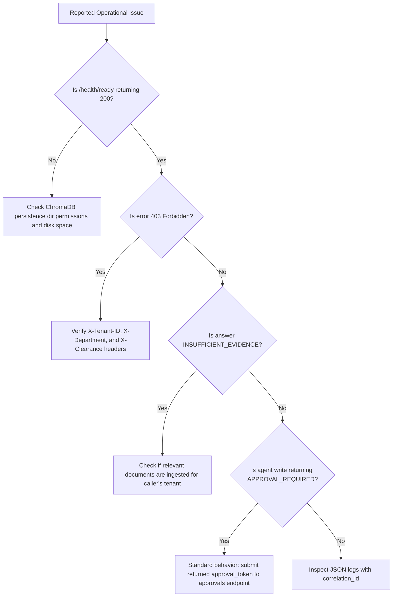

# Operational Troubleshooting Guide: Sentinel Enterprise AI Fabric

## 1. Diagnostic Decision Tree



---

## 2. Common Errors & Resolution Runbooks

### Error 1: `403 Forbidden: Cross-tenant access denied`
- **Symptom**: Client receives HTTP 403 or empty search results.
- **Root Cause**: The caller's `X-Tenant-ID` header does not match the tenant metadata assigned to the target document chunks or operation.
- **Resolution**: Confirm that the gateway is setting the authenticated user's verified tenant identifier. Tenant boundaries are strictly isolated and cross-tenant queries are blocked by design.

### Error 2: `429 Too Many Requests: Rate limit exceeded`
- **Symptom**: Requests return HTTP 429 with error message.
- **Root Cause**: The client IP has exceeded `RATE_LIMIT_PER_MINUTE` (default: 120 requests/minute).
- **Resolution**: Check for aggressive polling loops or configure higher limits in `.env` via `RATE_LIMIT_PER_MINUTE=300`.

### Error 3: Grounded Generator Returns `INSUFFICIENT_EVIDENCE`
- **Symptom**: RAG query returns `INSUFFICIENT_EVIDENCE: The authorized enterprise documentation does not contain sufficient verified evidence to answer this question.`
- **Root Cause**: Either no documents exist for the user's tenant/clearance, or retrieved candidate similarity scores fell below `GROUNDING_SCORE_THRESHOLD` (default: 0.45).
- **Resolution**:
  1. Confirm document has been indexed: query `POST /api/v1/search` with top_k=10.
  2. Verify user's clearance is greater than or equal to document clearance.
  3. If relevant content exists but vocabulary diverges significantly, consider tuning `GROUNDING_SCORE_THRESHOLD` in `.env`.

### Error 4: `400 Bad Request: Approval token has expired`
- **Symptom**: Submitting approval to `/api/v1/approvals/{operation_id}` fails with token expiry.
- **Root Cause**: The approval token exceeded `AGENT_APPROVAL_TTL_SECONDS` (default: 900 seconds / 15 minutes).
- **Resolution**: Re-initiate the write request to generate a fresh approval token.

---

## 3. Log Investigation with Correlation IDs

Every incoming request generates or retains a unique correlation ID (`X-Correlation-ID`). To trace an execution:
```bash
# Filter structured logs by correlation ID
cat /app/data/audit/audit_events.jsonl | grep "req-a1b2c3d4e5f6"
```
Logs contain sanitized error messages, exact module names, function names, and line numbers.
